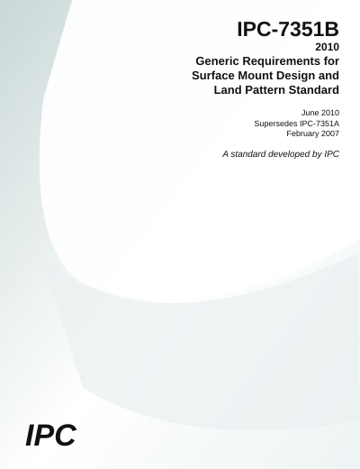

# IPC-7351B-2010

### Generic Requirements for Surface Mount Design and Land Pattern Standard

### [⬇️ **СКАЧАТЬ APK**](https://github.com/wadi-li/smd-footprints-ipc7351b-android/releases/latest/download/IPC7351B.apk)

**[Все версии и релизы](https://github.com/wadi-li/smd-footprints-ipc7351b-android/releases)** · **[Веб-версия](https://wadi-li.github.io/smd-footprints-ipc7351b-android/)**

## О приложении

Android-калькулятор посадочных мест SMD-компонентов по методике **IPC-7351B**. Рассчитывает посадочные места резисторов, конденсаторов MLCC и чип-дросселей для плотностей **Level A, B, C**. Поддерживает коррекцию «без свешивания», экспорт **CSV / JSON / KiCad `.kicad_mod` / Markdown**, тёмную тему и встроенную инструкцию. Работает офлайн.

> **Важно:** это независимое приложение по методике IPC-7351B, а не официальный IPC Land Pattern Calculator и не полный комплект библиотеки корпусов стандарта. Ссылка на APK начинает работать после успешной публикации GitHub Actions Release.

## Оригинальное описание стандарта (English)

**IPC 7351B-2010 — Generic Requirements for Surface Mount Design and Land Pattern Standard**

IPC-7351B land pattern calculator on CD-ROM for accessing component and land pattern dimensional data. The calculator includes the document’s mathematical algorithms so users can build a land pattern for a corresponding surface mount part quickly and accurately. The tool also allows for modification of dimensional attributes of IPC approved land patterns.

This popular document covers land pattern design for all types of passive and active components, including resistors, capacitors, MELFs, SOPs, QFPs, BGAs, QFNs and SONs. The standard provides printed board designers with an intelligent land pattern naming convention, zero component rotations for CAD systems and three separate land pattern geometries for each component that allow the user to select a land pattern based on desired component density.

Revision B includes land pattern design guidance and rules for component families such as resistor array packages, aluminum electrolytic capacitors, column and land grid arrays, flat lead devices (SODFL and SOTFL) and dual flat no-lead (DFN) devices. The revision also discusses the usage of thermal tabs and provides a new padstack naming convention that addresses the shape and dimensions of lands on different layers of printed boards.

**Источник:** [IPC — IPC-7351B (June 2010)](https://www.ipc.org/TOC/IPC-7351B.pdf). Описание относится к стандарту и историческому официальному калькулятору на CD-ROM, а не к функциональности данного Android-приложения.

## Установка APK

Android **7.0+**. Скачайте `IPC7351B.apk`, откройте его на телефоне и при необходимости разрешите установку приложений из выбранного источника. Сборка GitHub Actions использует debug-подпись; перед установкой новой сборки с другим ключом может потребоваться удалить старую версию.

## Структура проекта

| Путь | Назначение |
|---|---|
| `docs/index.html` | Интерфейс и стили |
| `docs/app.js` | Библиотека компонентов, расчёты и экспорт |
| `docs/help.js` | Встроенная инструкция |
| `app/` | Android-обёртка WebView |
| `.github/workflows/build-apk.yml` | Сборка и публикация APK |
| `.github/workflows/pages.yml` | Публикация веб-версии |

Для обновления коэффициентов или библиотеки редактируйте `docs/app.js`. Версию Android меняйте в `app/build.gradle`, версию PWA-кэша — в `docs/sw.js`.
